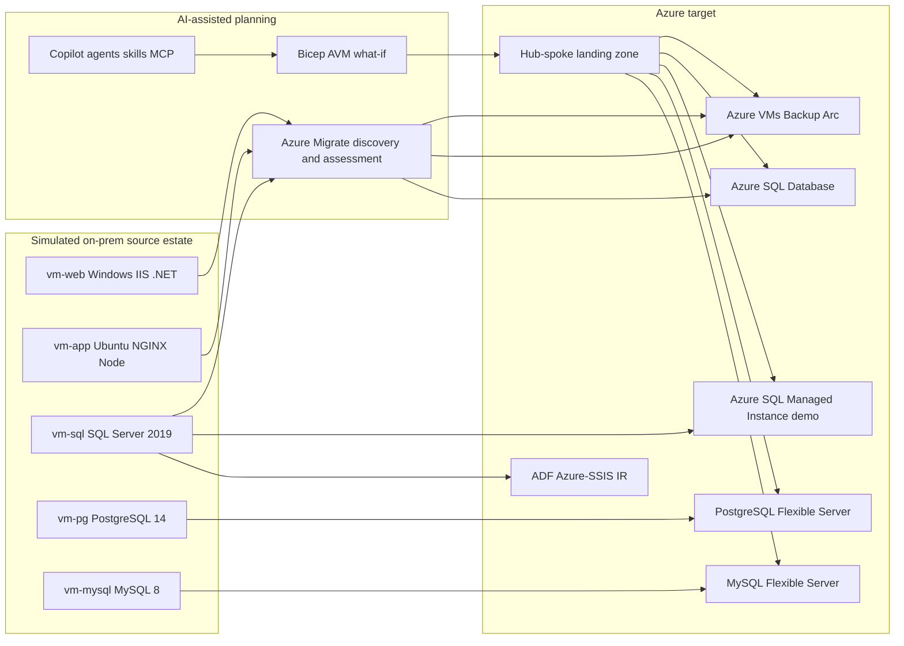

## Source to target view

## Naming conventions

Use `rg-ttmh-*` for resource groups, `sql-ttmh-*` for Azure SQL Database servers, `sqlmi-ttmh-*` for Managed Instance demos, `psql-ttmh-*` for PostgreSQL Flexible Server, `mysql-ttmh-*` for MySQL Flexible Server, and `adf-ttmh-*` for Data Factory.
