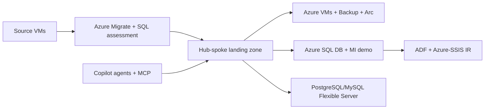

<!-- markdownlint-disable MD025 MD003 -->

# Migrate & Modernize to Azure — MicroHack

## Train-the-Trainer for Module B

Infrastructure and Database Migration to Microsoft Azure Advanced Specialization

<!-- Welcome trainers. Emphasize that they will do the labs and learn how to teach them. -->

---

# Why migrate and modernize?

- Datacenter exits need speed and defensible decisions.
- Customers rarely migrate one technology stack at a time.
- Evidence matters: assessment, target choice, controls, cutover, hypercare.
- AI helps accelerate analysis, but humans approve risk and change.

<!-- Tie this to partner delivery quality and customer confidence. -->

---

# Tailwind Traders estate

| Source | Platform | Target pattern |
| --- | --- | --- |
| vm-web | Windows Server, IIS, .NET | Azure VM rehost |
| vm-app | Ubuntu, NGINX, Node | Azure VM rehost |
| vm-sql | SQL Server 2019 | Azure SQL DB and MI demo |
| vm-pg | PostgreSQL 14 | PostgreSQL Flexible Server |
| vm-mysql | MySQL 8 | MySQL Flexible Server |

<!-- Explain the estate is deployed to Azure to simulate on-premises safely. -->

---

# AI-accelerated migration

- GitHub Copilot agents: Engagement Copilot, IaC Architect, Schema Converter.
- Skills and MCP servers add repo, Azure, and GitHub context.
- Modular inference lets the trainer choose `INFERENCE_PROVIDER`.
- Agent outputs become auditable artifacts.

<!-- Reinforce: agents draft, consultants decide. -->

---

# Source to target architecture

<!-- Walk the room through the three migration pillars. -->

---

# Ch00 Setup & Source Estate

- Authenticate Azure and GitHub.
- Open Codespaces or devcontainer.
- Enable MCP servers and custom agents.
- Deploy `rg-ttmh-source` with `vm-*` workloads.

<!-- Watch for subscription and tenant mistakes. -->

---

# Ch01 Discovery & Assessment

- Azure Migrate project, discovery, and server assessment.
- MSSQL extension and Azure SQL migration assessment flow.
- Engagement Copilot reads `assessment.json`.
- Output: `01-assessment.md`.

<!-- Keep server and database assessments distinct. -->

---

# Ch02 Landing Zone via Agentic IaC

- Intent to architecture with IaC Architect.
- Bicep Azure Verified Modules.
- `az deployment group what-if` before deployment.
- Output: architecture and IaC plan.

<!-- This is the governance moment: no approval, no deploy. -->

---

# Ch03 IaaS Rehost

- Azure Migrate Server Migration for web and app tiers.
- Test migration before cutover.
- Enable Backup, Defender for Cloud, and Arc evidence.
- Explain why rehost can be an intentional first step.

<!-- Ask attendees how they would explain rehost value to a skeptical customer. -->

---

# Ch04 Azure SQL Family

- Azure SQL Database migration for compatible workloads.
- Cross-database blocker drives MI conversation.
- SSIS moves to ADF Azure-SSIS IR.
- Agent jobs map to Elastic Jobs or MI Agent.

<!-- Use pre-provisioned MI and IR assets to avoid waiting. -->

---

# Ch05 OSS DB PaaS

- PostgreSQL `TailwindCatalog` to Flexible Server.
- MySQL `TailwindSessions` to Flexible Server.
- Validate counts, connectivity, backups, and private access.
- Reinforce customer diversity.

<!-- Flexible Server is about managed operations, not just a new endpoint. -->

---

# Ch06 Cutover, Audit Evidence & Hypercare

- Generate T-14, T-0, and T+14 runbook.
- Build B.4.1 evidence index.
- Package B.4.2 onboarding assets.
- Practice a 5-minute teach-back.

<!-- The final lab turns technical work into specialization proof. -->

---

# Module B proof points

| Control | Evidence |
| --- | --- |
| B.2.1 ACR performance | Sizing, monitoring, Backup, Defender |
| B.2.2 Customer diversity | IaaS, SQL, PostgreSQL, MySQL, SSIS |
| B.4.1 Audit readiness | `what-if`, reports, runbook, evidence index |
| B.4.2 Onboarding assets | KT, hypercare, trainer reusable assets |

<!-- Encourage trainers to say the control name during delivery. -->

---

# Certification alignment

- AZ-104: Azure admin, VMs, Backup, Monitor, RBAC.
- AZ-305: architecture tradeoffs, landing zone, resiliency.
- DP-300: Azure SQL operations and migration target decisions.
- AZ-800/801: Windows Server, hybrid, Arc, migration operations.

<!-- Certifications validate the same skills practiced in the lab. -->

---

# Closing and CTA

1. Run the labs.
2. Teach the decision points.
3. Preserve evidence.
4. Improve the next cohort.

**Your job:** make migration delivery repeatable, explainable, and auditable.

<!-- Close by assigning teardown and asking each pair for one teach-back insight. -->
